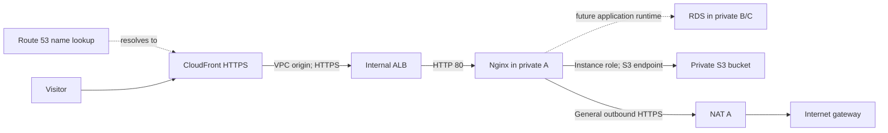

# memis.cloud architecture workspace

An AWS reference architecture and reusable delivery workspace, with GitHub Copilot instructions, skills, and prompts.

**Start with [the simple guide](docs/start-here.md)** or [the Copilot walkthrough](tutorials/04-copilot-memis-cloud.md).

The design uses Route 53, CloudFront with a VPC origin, an internal Application Load Balancer, a private Nginx instance, RDS PostgreSQL, and a private S3 bucket. Three public and three private subnets span three Availability Zones. Terraform describes the infrastructure; the framework records decisions, plans, and evidence.

**Status:** this is an architecture and configuration package. The [validation record](docs/validation-report.md) distinguishes actual local checks from live tests not run. No AWS resources were deployed. The supplied Nginx page is a bootstrap service, with business-runtime integration left explicit.



The dotted DB connection is planned runtime connectivity. Nginx itself supplies neither product logic nor database queries.

| I want to… | Open |
|---|---|
| Understand the design | [Simple guide](docs/start-here.md) |
| Inspect requirements and tradeoffs | [Scope](projects/memis-cloud/docs/scope.md) · [Architecture](projects/memis-cloud/docs/architecture.md) |
| Inspect subnets and access rules | [Network and access](projects/memis-cloud/docs/network-and-access.md) |
| Review work and evidence | [Deliverables](projects/memis-cloud/deliverables.yaml) · [Validation](docs/validation-report.md) |
| Continue with Copilot | [Copilot tutorial](tutorials/04-copilot-memis-cloud.md) |
| Validate or prepare rollout | [Setup](projects/memis-cloud/docs/setup.md) · [Operations](projects/memis-cloud/docs/operations.md) |
| Reuse the method | [Adaptation analysis](docs/framework-adaptation.md) · [Reuse tutorial](tutorials/05-reuse-this-workspace.md) |
| Understand the handoffs | [File contracts](docs/file-contracts.md) |

## Local checks

Requires Python 3.11+ and Terraform 1.11+. Run from the repository root:

```sh
python3 -m venv .venv
.venv/bin/python -m pip install -r requirements.txt
.venv/bin/python scripts/verify_workspace.py
terraform -chdir=projects/memis-cloud/infra init -backend=false -input=false
terraform -chdir=projects/memis-cloud/infra fmt -check -recursive
terraform -chdir=projects/memis-cloud/infra validate
terraform -chdir=projects/memis-cloud/infra test
```

Mocked Terraform tests do not provision AWS resources. A real plan and live smoke checks are separate steps in the setup guide.

## Workspace map

```text
skills/                         Canonical seven reusable skills
.github/skills/                 Generated Copilot copies
.github/prompts/                Seven explicit workflow entry points
.github/instructions/           Guidance scoped by file patterns
project.yaml deliverables.yaml Root integration project
projects/memis-cloud/           AWS project: docs, plans, evidence, configuration
projects/memis-cloud/infra/     Terraform and mocked tests
schemas/ templates/ scripts/    Framework contracts and helpers
examples/                       Small document and software examples
```

Based on [Reusable Delivery Framework](https://github.com/memiscet/reusable-delivery-framework), snapshot `6cbbcb5`. Framework material is reused under its MIT license; see [provenance](docs/provenance.md) and [LICENSE](LICENSE).
