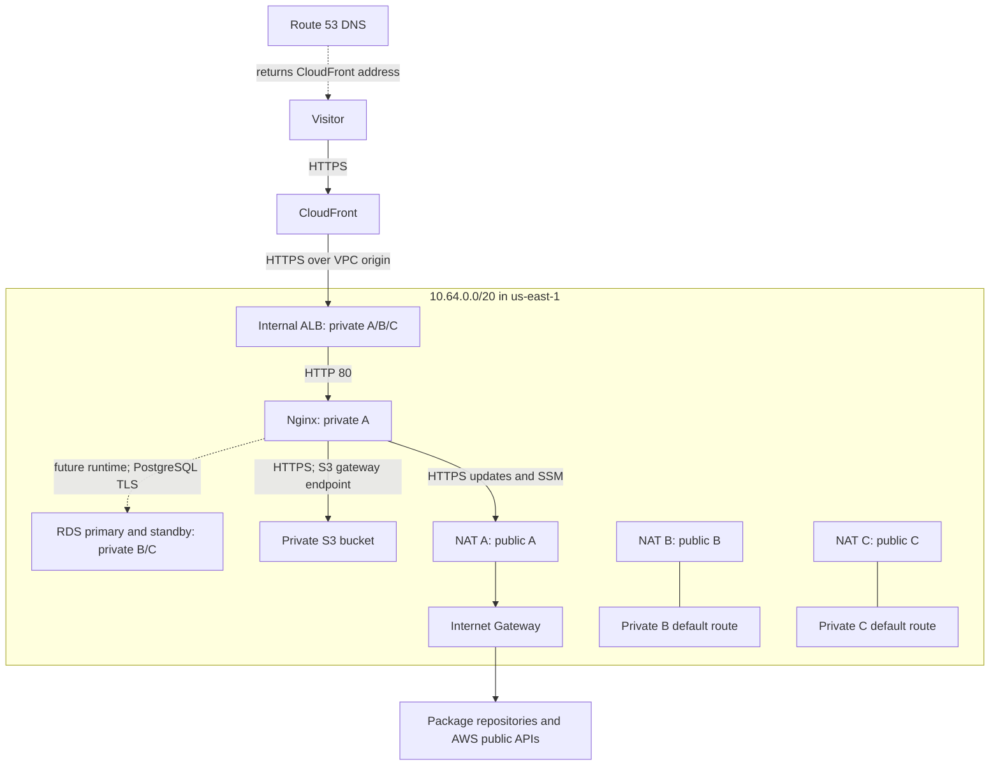

# Architecture: memis.cloud

## Overview
CloudFront's VPC origin connects privately to an internal Application Load Balancer (ALB), which forwards requests to Nginx on private EC2. RDS and S3 support a future application runtime. NAT supplies instance-initiated internet access for maintenance. The reference region is us-east-1, simplifying certificate placement.

Route 53 answers DNS queries; it is not a reverse proxy in the HTTP path. Apex A and AAAA aliases point at CloudFront. The VPC and origin use IPv4; CloudFront can still accept IPv6 viewers.

## Components and responsibilities

| Component | Responsibility | Dependencies |
|---|---|---|
| Existing public Route 53 zone | Domain and ACM validation records | Operator-supplied zone ID |
| ACM certificate | memis.cloud HTTPS identity in us-east-1 | DNS validation |
| CloudFront distribution | HTTPS entry and uncached request forwarding | VPC origin, certificate, ALB |
| CloudFront VPC origin | Private origin connectivity | Active ALB, IGW attachment, free subnet IPs |
| Internal ALB | HTTPS listener, health checks, forwarding | Three private subnets and Nginx target |
| EC2 Nginx | Bootstrap page and /healthz | Private A, NAT A, SSM role |
| Application runtime | Future business logic, DB queries, uploads | Product requirements not yet supplied |
| RDS PostgreSQL | Managed relational database | Private B/C subnet group, DB security group |
| S3 | Objects under application/ | Instance role, gateway endpoint |
| Zonal NAT Gateways | Private-subnet outbound defaults | Public subnets, Elastic IPs, IGW |

## Diagram

The dotted database path is planned runtime integration; the bootstrap Nginx page does not execute SQL.

## Private CDN origin
Use a VPC origin, not a conventional internet-facing custom origin. AWS requires an attached IGW and free private addresses for service-managed interfaces; this does not require public routes for the origin. After origin creation, an ALB ingress rule references AWS's CloudFront VPC-origin security group. Never modify that AWS-owned group. [AWS VPC origins](https://docs.aws.amazon.com/AmazonCloudFront/latest/DeveloperGuide/private-content-vpc-origins.html).

The referenced service excludes gRPC and Lambda@Edge origin request/response triggers. Recheck current support if those become requirements. Creating service-linked roles and available account quotas remain rollout prerequisites, not conclusions of a local configuration test.

## HTTPS and forwarding
Request a DNS-validated memis.cloud certificate in us-east-1. CloudFront redirects HTTP viewers to HTTPS and uses HTTPS-only on port 443 to the ALB. Both use this certificate because the origin is also in us-east-1. The AllViewer origin-request policy forwards the viewer Host header. That enables origin certificate matching against memis.cloud while the origin domain field contains the ALB DNS name. [Origin certificate matching](https://docs.aws.amazon.com/AmazonCloudFront/latest/DeveloperGuide/using-https-cloudfront-to-custom-origin.html); [certificate regions](https://docs.aws.amazon.com/AmazonCloudFront/latest/DeveloperGuide/cnames-and-https-requirements.html).

Disable default caching because application behavior is unknown. Queries, cookies, and authorization reach the origin. Add static caching only after identifying safe paths. ALB-to-Nginx uses HTTP 80 within security-group boundaries; this is not encryption on every hop. Instance TLS and an HTTPS target group are a separate enhancement if required.

## Placement and tradeoffs
The [allocation](../network.yaml) and [network guide](network-and-access.md) define six /24 subnets inside a /20. Nginx occupies private A. RDS's subnet group uses private B/C, satisfying its cross-AZ requirement and keeping DB instances out of Nginx's subnet. ALB interfaces share all three private subnets. This meets six subnets but does not provide dedicated application and database tiers in every AZ. [RDS VPC guidance](https://docs.aws.amazon.com/AmazonRDS/latest/UserGuide/USER_VPC.WorkingWithRDSInstanceinaVPC.html).

The alternative is nine subnets: three public, three private application, and three isolated database subnets. It separates database route tables from NAT and permits application instances across three AZs. This alternative is not substituted into the baseline.

## Database and credentials
Propose RDS PostgreSQL 17, a Multi-AZ DB instance, encrypted storage, seven days of backups, deletion protection, and a final snapshot. Confirm exact engine/class availability before apply. A parameter group requires SSL; the future runtime must verify the RDS CA and hostname. A standby is for failover rather than read scaling.

RDS manages the administrator password in Secrets Manager. The EC2 role cannot retrieve that administrator secret. Before integration, an operator creates a least-privilege DB user and a separate application secret. The optional application-secret input grants access only to that ARN; an optional customer-managed key input scopes its decrypt permission. Passwords are absent from user data and Terraform inputs. [RDS password management](https://docs.aws.amazon.com/AmazonRDS/latest/UserGuide/rds-secrets-manager.html).

## Storage and maintenance
The instance role can list application/ and read/write its objects, without delete permission. S3 blocks public access, uses SSE-S3, retains versions, and denies non-TLS requests. A gateway endpoint on all private route tables allows this bucket plus read-only access to the AL2023 repository. Its specific service route takes precedence over NAT. See [the repository exception](network-and-access.md) and [S3 gateway endpoints](https://docs.aws.amazon.com/vpc/latest/privatelink/vpc-endpoints-s3.html).

Package updates and Systems Manager use outbound HTTPS via NAT. Internet clients cannot initiate inbound connections through NAT. Three NATs avoid one shared zonal dependency at additional cost. [NAT Gateways](https://docs.aws.amazon.com/vpc/latest/userguide/vpc-nat-gateway.html). SSM also needs its agent, instance role, operator permissions, and endpoint connectivity. [Session Manager prerequisites](https://docs.aws.amazon.com/systems-manager/latest/userguide/session-manager-prerequisites.html).

## Availability and limits
The single Nginx instance remains an application single point of failure. Managed edge, ALB, database resilience, and three NATs do not eliminate that limit. Certificate mismatch, bootstrap failure, or missing runtime configuration can still interrupt service. See [operations](operations.md). No measured availability, latency, RTO, or RPO is claimed.
